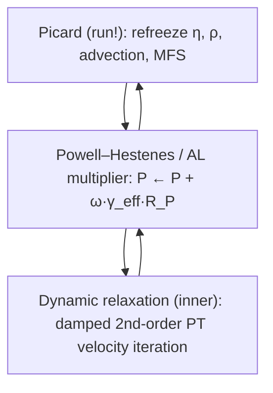

# xcore DYREL + GMG: theory and departures from Duretz et al. (2025)

This note documents the mathematics of xcore's matrix-free Stokes solvers — the
single-grid dynamic-relaxation solver (`:dyrel`, `src/dyrel/`) and the geometric
multigrid solver built on top of it (`:gmg`, `src/dyrel_GMG/`) — and states
precisely **where and why we depart from the auto-tuned pseudo-transient (PT)
method of Duretz et al. (2025, GMD)** and its JustRelax.jl reference
implementation. The two structural departures are (i) an **operator-derived,
per-cell augmented-Lagrangian penalty built from the diagonal of the pressure
Schur complement** (replacing the constant viscosity-scaled penalty), and (ii)
a **correction-scheme geometric multigrid V-cycle that uses the DR sweep as its
smoother**, with a pseudo-transient compressibility reference that makes the
fixed point exact. Both are forced by physics Duretz et al. do not have:
inertia and compressible two-phase continuity.

> [!abstract] TL;DR
> Duretz et al. (2025) auto-tune PT for **incompressible visco-elasto-plastic
> creeping Stokes**, where the Schur complement scales like $\eta^{-1}$ and a
> constant penalty $\gamma = \gamma_{\rm fact}\langle\eta\rangle$ works. xcore
> solves **compressible two-phase Navier–Stokes at $\mathrm{Re}>1$**: the BD2
> inertia diagonal $a_1\rho/\Delta t$ dominates the momentum operator, so the
> Schur complement is spatially variable and inertia-scaled, and the constant
> penalty mis-converges by orders of magnitude. We keep their auto-tuning
> machinery (Gershgorin $\lambda_{\max}$, Rayleigh $\lambda_{\min}$) but extend
> the Gershgorin bound with the inertial diagonal, derive the penalty per cell
> from the **Schur diagonal** $s_P = \mathrm{diag}(G^\top D^{-1} G)$, and wrap
> the whole solver in a geometric V-cycle. Result: a single dimensionless
> $\gamma_{\rm fact}$ across all regimes, textbook grid-independent V-cycle
> counts (~6), and a matrix-free solver that beats the sparse-LU direct path by
> 2× at $N=256$ (growing with $N$), with identical $\sim 10^{-13}$ mass
> conservation.

---

## 1. The continuous problem

xcore solves compressible two-phase Navier–Stokes at $\mathrm{Re}>1$ on a 2-D
staggered (MAC) grid, periodic in $x$, closed in $z$. With deviatoric stress
$\boldsymbol{\tau} = 2\eta\,(\dot{\boldsymbol{\varepsilon}} -
\tfrac13(\nabla\!\cdot\!\mathbf v)\,\mathbf I)$:

$$
\nabla\!\cdot\!\boldsymbol{\tau} - \nabla P + \rho\,\mathbf g
\;-\; \rho\,\partial_t \mathbf v \;-\; \nabla\!\cdot\!(\mathbf v \otimes \rho\mathbf v) \;=\; \mathbf 0
\qquad \text{(momentum)}
$$

$$
\nabla\!\cdot\!(\rho\,\mathbf v) \;=\; \mathrm{MFS}
\qquad \text{(mass)}
$$

Three things distinguish this from the creeping-Stokes setting of Duretz et
al.:

1. **Inertia.** Time integration is BD2; the momentum operator carries an
   implicit inertial term $a_1\rho\,\mathbf v/\Delta t$ (with the lagged
   momentum-flux history $\,(a_2\rho\mathbf v^{\circ} + a_3\rho\mathbf
   v^{\circ\circ})/\Delta t$ on the right-hand side). For dense phases
   ($\rho \sim 10^3$) this is a **large positive diagonal** that dominates the
   viscous stencil.
2. **Momentum advection** $\nabla\!\cdot\!(\mathbf v\otimes\rho\mathbf v)$,
   frozen at the entry velocity within each linear solve and updated by the
   outer Picard loop.
3. **Compressible two-phase continuity.** The constraint is on the **mass
   flux** $\nabla\!\cdot\!(\rho\mathbf v)$, not on $\nabla\!\cdot\!\mathbf v$;
   the source $\mathrm{MFS}$ accumulates the $\partial_t\rho$ correction from
   the phase-evolution equation across Picard sweeps. Since
   $\int_\Omega \mathrm{MFS}\,dV \neq 0$ in general, the net source must leave
   the domain: the bottom boundary carries a prescribed drain
   $W_{\rm bot} = \overline{\mathrm{MFS}}\,D/\rho_w$ (this is what closes the
   global mass budget to machine precision).

A drunken-sailor stabilisation term $g\,\partial_z\rho\,\Delta t\,W$ is
included in the momentum diagonal (Duretz et al. do not need it — they have no
density-driven temporal instability at $\Delta t$-scale).

---

## 2. The discrete saddle point

Freezing the nonlinear coefficients ($\eta$, $\rho$, advection, BD2 history) —
which is exact *within* one linear solve; the Picard loop in `run!` refreshes
them — the discrete system is the generalised saddle point

$$
\begin{pmatrix} K & G \\ \mathcal D & 0 \end{pmatrix}
\begin{pmatrix} \mathbf v \\ P \end{pmatrix}
=
\begin{pmatrix} \mathbf f \\ b_c \end{pmatrix},
\qquad
\begin{aligned}
K &= \underbrace{-\nabla\!\cdot 2\eta\,\dot{\boldsymbol\varepsilon}(\cdot)}_{\text{viscous, SPD}}
  \;+\; \underbrace{\tfrac{a_1\rho}{\Delta t}\,\mathbf I}_{\text{BD2 inertia}}
  \;+\; \text{(sailor diag.)},\\[2pt]
G &= \nabla(\cdot) \ \text{(pressure gradient)},\qquad
\mathcal D = \tfrac{1}{\rho}\,\nabla\!\cdot\!(\rho\,\cdot).
\end{aligned}
$$

Two discrete conventions matter throughout:

- **The constraint block is not the adjoint of the gradient**:
  $\mathcal D \neq G^\top$ because of the face densities $\rho_f$ and the
  $1/\rho$ row scaling. The $1/\rho$ scaling of the continuity residual is
  deliberate and load-bearing (§4.3): it makes the penalty injected into
  momentum dimensionally consistent with the Gershgorin bound, which carries
  no $\rho$.
- **Residual sign.** xcore computes $R = b - A v$ (a descent direction for the
  velocity update), the *opposite* sign of the MATLAB prototype. This flips
  the sign of the coarse-grid correction in §6 ($v \mathrel{+}= \gamma\,e$,
  not $-\!=$).

The matrix-free residual kernels were verified **identical to the assembled
direct-solver operator to $10^{-12}$** — every fix described below is a
*solver* (convergence-rate) matter, not an operator discrepancy.

---

## 3. Solver architecture: three nested iterations

- **Picard** handles the nonlinearity (constitutive + phase coupling within a
  BD2 step). Identical for `:direct`, `:dyrel`, `:gmg`.
- **Powell–Hestenes (PH)** is the augmented-Lagrangian multiplier iteration
  for the incompressibility-like constraint (§4).
- **Dynamic relaxation (DR)** is the accelerated pseudo-transient velocity
  solve (§5) — this is the layer taken from Duretz et al. (2025).

In `:gmg`, the PH+DR pair becomes the *smoother* of a V-cycle (§6); the Picard
loop is unchanged.

---

## 4. Augmented Lagrangian and the Schur complement — the first departure

### 4.1 Standard Powell–Hestenes (Duretz et al. / JustRelax)

The constraint is enforced by an augmented-Lagrangian (Powell–Hestenes/Uzawa)
iteration: solve momentum with a penalty, then update the multiplier,

$$
(K + \text{penalty})\,\mathbf v^{k} = \mathbf f - G P^{k},
\qquad
P^{k+1} = P^{k} + \omega\,\gamma\,R_P(\mathbf v^k, P^k),
$$

with the penalty injected into momentum as a numerical pressure
$P_{\rm num} = \gamma\,R_P$ and an artificial-compressibility regularisation

$$
R_P = \frac{1}{\rho}\Big(\mathrm{MFS} - \nabla\!\cdot\!(\rho\mathbf v)\Big) - \frac{P - P_0}{\eta_b\,\Delta t}.
$$

For this stationary iteration to contract, $\omega\gamma$ must approximate the
inverse of the **pressure Schur complement**

$$
S \;=\; \mathcal D\,K^{-1} G,
$$

the operator mapping a pressure increment to the continuity defect it induces.
Duretz et al. and JustRelax take a **constant** $\gamma = \gamma_{\rm
fact}\,\langle\eta\rangle$ with $\gamma_{\rm fact}\approx 20$. This is correct
*in their regime*: for incompressible creeping Stokes $K \sim \eta\nabla^2$,
hence $S \sim \eta^{-1}$ is (locally) a scaled identity and a viscosity-scaled
scalar is a good preconditioner of the multiplier update.

### 4.2 Why this fails at $\mathrm{Re}>1$

In xcore, $K \sim \tfrac{a_1\rho}{\Delta t}\mathbf I + \eta\nabla^2$ is
**inertia-dominated**. Then

$$
S \;\sim\; \mathcal D \left(\frac{a_1\rho}{\Delta t}\right)^{-1} G
\;\sim\; \frac{\Delta t}{a_1\rho}\,\nabla^2,
$$

which is (a) much *smaller* than the creeping-Stokes Schur complement, (b)
spatially variable through $\rho(\mathbf x)$ and $\eta(\mathbf x)$, and (c)
$\Delta t$-dependent. A constant $\gamma_{\rm fact}\langle\eta\rangle$
mis-scales the multiplier update by orders of magnitude — empirically the
solver needed $\gamma_{\rm fact}\sim 10^3$ ($\approx 50\times$ the JustRelax
value) to limp along, with the PH loop routinely hitting its iteration cap.
On coarse multigrid levels the same mis-scaling shows up as penalty locking.

### 4.3 The fix: per-cell penalty from the Schur diagonal

We approximate $S^{-1}$ by the inverse of its **diagonal** — a Jacobi
preconditioner for the Schur complement — using the cheap Gershgorin/Jacobi
momentum diagonal $D_f$ (§5.1) as a proxy for $K^{-1}$ face by face. For cell
$i$ with its four faces $f$, the staggered-grid couplings are

$$
\frac{\partial (R_P)_i}{\partial v_f} = \mp\frac{\rho_f}{h\,\rho_i},
\qquad
\frac{\partial (R_v)_f}{\partial P_i} = \pm\frac{1}{h},
\qquad
(K^{-1})_{ff} \approx \frac{1}{D_f},
$$

so that (`compute_schur_diag!` in `src/dyrel/gershgorin.jl`)

$$
\boxed{\;
s_P[i] \;=\; \frac{1}{h^2\rho_i}\sum_{f\,\in\,\partial i} \frac{\rho_f}{D_f}
\;=\; \frac{1}{h^2\rho_i}\!\left(
\frac{\rho^u_W}{D^U_W} + \frac{\rho^u_E}{D^U_E} +
\frac{\rho^w_N}{D^W_N} + \frac{\rho^w_S}{D^W_S}\right).}
$$

The penalty is then built **per cell from the penalty-free operator**
(`compute_AL_penalty!` in `src/dyrel/init.jl`): evaluate the Gershgorin
diagonal with $\gamma_{\rm eff}=0$ (viscous + inertia only, avoiding
self-reference), form $s_P^{\rm phys}$, and set

$$
\boxed{\;\gamma_{\rm eff}[i] \;=\; \frac{\gamma_{\rm fact}}{s_P^{\rm phys}[i]},\qquad \eta_b[i] = \gamma_{\rm eff}[i].}
$$

Three properties make this the right object:

1. **Dimensional closure.** $s_P$ has units $[\mathrm{s\,m\,kg^{-1}}]$, so
   $1/s_P$ is a viscosity $[\mathrm{Pa\,s}]$ that carries the *full* operator
   scaling — viscous $\eta$ plus the inertial $a_1\rho h^2/\Delta t$
   contribution. Consequently **$\gamma_{\rm fact}$ is a single dimensionless,
   scale-invariant constant**: the value $\gamma_{\rm fact}=50$ was validated
   without retuning across $\eta\in[10^{-1},10^4]$, domain depths
   $D\in[10,100]$, density rescalings, and grid sizes. In the limit
   $\Delta t\to\infty$, $s_P$ is viscous-dominated and the
   creeping-Stokes penalty of Duretz et al. is recovered — their scheme is the
   inertia-free special case of ours.
2. **$\rho$-cancellation.** With $R_P$ scaled by $1/\rho$ (§2), the multiplier
   step $\Delta P_i = \omega\,\gamma_{\rm eff}[i]\,(R_P)_i$ is the *physical
   mass-flux defect divided by the Schur diagonal* — the large constant
   density that previously forced $\gamma_{\rm fact}$ to blow up cancels
   exactly.
3. **Consistency in all three roles.** The *same* field $\gamma_{\rm eff}$ is
   used as (i) the momentum penalty $P_{\rm num} = \gamma_{\rm eff} R_P$, (ii)
   the multiplier step $P \mathrel{+}= \omega\,\gamma_{\rm eff} R_P$, and
   (iii) the artificial-compressibility coefficient $\eta_b$. Mixing scalings
   between these roles (an earlier design) destabilises the AL iteration.

> [!note] Fixed point unchanged
> Any positive scaling of the multiplier update has the same fixed point
> $R_P \to 0$: the Schur-diagonal scaling is a **preconditioner of the
> multiplier iteration**, not a modification of the discrete equations. The
> converged $(\mathbf v, P)$ is the saddle-point solution either way — only
> the contraction rate changes. This is why conservation statistics are
> bitwise comparable with the direct solver.

A related, smaller departure: the free constant-pressure mode (periodic-$x$,
closed-$z$) is pinned with the **$\gamma_{\rm eff}$-weighted gauge**
$\sum_i (P_i - P_{0,i})/\gamma_{\rm eff}[i] = 0$, which is the discrete
solvability condition making the compressibility term integrate to zero;
an unweighted mean leaves a constant residual floor at high $N$.

---

## 5. Accelerated pseudo-transient velocity solve (adopted, then extended)

### 5.1 The Duretz et al. (2025) machinery we keep

The velocity sub-solve $(K + \text{penalty})\,\mathbf v = \mathbf f - GP$ is
driven to steady state by damped second-order Richardson iteration (dynamic
relaxation; Frankel 1950; Räss et al. 2022):

$$
\frac{\partial^2 \mathbf v}{\partial \tau^2} + c\,\frac{\partial \mathbf v}{\partial \tau}
= D^{-1} R(\mathbf v),
$$

discretised, per face, as

$$
d\mathbf v^{k+1} = \alpha\, d\mathbf v^{k} + D^{-1}R^k,\qquad
\mathbf v^{k+1} = \mathbf v^{k} + \beta\,\Delta\tau\, d\mathbf v^{k+1},
$$

with the auto-tuned optimal parameters of Duretz et al.:

$$
\Delta\tau = \frac{2\,\mathrm{CFL}}{\sqrt{\lambda_{\max}}}\ \ \text{(per face)},\qquad
c = 2\sqrt{\lambda_{\min}}\,c_{\rm fact}\ \ \text{(global)},
$$

$$
\alpha = \frac{2 - c\,\Delta\tau}{2 + c\,\Delta\tau},\qquad
\beta = \frac{2\,\Delta\tau}{2 + c\,\Delta\tau}.
$$

$\lambda_{\max}$ is a per-face Gershgorin row-sum bound on the Jacobi-preconditioned
operator $D^{-1}A$; $\lambda_{\min}$ is a Rayleigh quotient evaluated on the
running iteration every $n_{\rm tune}$ steps,

$$
\lambda_{\min} \approx
\frac{\big|\sum \delta\mathbf v\cdot(R - R_{\rm old})\big|}{\sum \delta\mathbf v\cdot\delta\mathbf v}.
$$

This is exactly their algorithm and we use it verbatim as the *adaptive*
single-grid driver.

### 5.2 What changes in the Gershgorin bound

The bound itself is extended and corrected for xcore's operator
(`src/dyrel*/gershgorin.jl`):

- **No visco-elastic $G\Delta t$ terms, no plasticity** — xcore is purely
  viscous in $\tau = 2\eta(\dot\varepsilon - \tfrac13\nabla\!\cdot\!\mathbf v\,\mathbf I)$;
  the JustRelax visco-elasto-plastic coefficients drop out.
- **BD2 inertial diagonal included.** Each face adds
  $\delta = a_1\rho_f/\Delta t$ (for $U$: $(a_1+\gamma)\rho_f/\Delta t$, the
  horizontal-inertia coefficient) to both the diagonal $D$ and the row sum.
  Because $\delta>0$ enters numerator and denominator of
  $\lambda_{\max} = (C_{\rm self} + C_{\rm cross} + \delta)/D$, inertia
  *regularises* the spectrum — it raises $D$, lowers $\lambda_{\max}$, and
  enlarges $\Delta\tau$. At $\mathrm{Re}>1$ the momentum block is strongly
  diagonally dominant and the DR solve is cheap; the stiffness lives entirely
  in the constraint (which is why the Schur treatment of §4 is where the work
  went). The drunken-sailor term is deliberately *excluded* from the bound (a
  small sign-indefinite stabilisation that could render $D$ non-positive).
- **FD-verified diagonal coefficients.** The viscous row-sum coefficients for
  xcore's $\eta(\dot\varepsilon-\tfrac13\nabla\!\cdot\!\mathbf v\,\mathbf I)$
  convention were verified against finite differences of the actual kernels
  ($c_n = 2/3$, $c_c = 1/3$, $c_s = 1/2$), rather than carried over from the
  JustRelax stress convention. The penalty $\gamma_{\rm eff}$ enters the row
  sums with coefficient 1.

### 5.3 Artificial-compressibility reference $P_0$: two regimes

The term $\mathrm{comp} = (P - P_0)/(\eta_b\,\Delta t)$ gives the pressure
equation a diagonal restoring force that makes the AL iteration contract
geometrically. The reference $P_0$ matters more than it looks: a *frozen*
entry snapshot biases the converged solution, since the fixed point then
satisfies $\nabla\!\cdot\!(\rho\mathbf v) = \mathrm{MFS} - \mathrm{comp}$ with
$\mathrm{comp} = (P - P_0^{\rm entry})/(\eta_b\Delta t) \neq 0$ — an
$O(1/\gamma_{\rm fact})$ perturbation that can exceed the outer Picard
tolerance at finite $\Delta t$. The two solvers resolve this differently
(deliberately):

- **`:dyrel` (single grid)** keeps $P_0$ frozen within the solve; the bias is
  absorbed by the Picard loop ($P_0$ = previous sweep). Tracking $P_0$
  per PH step *weakens* the restoring force and stalls the high-$N$
  multiplier iteration (measured), so it is not done here.
- **`:gmg`** advances $P_0 \leftarrow P$ after **each V-cycle** — the standard
  pseudo-transient artificial-compressibility formulation ($P_0$ = previous
  outer iterate). Then $\mathrm{comp}\to 0$ as the V-cycles converge and the
  fixed point is $\nabla\!\cdot\!(\rho\mathbf v) = \mathrm{MFS}$ **exactly, at
  any $\gamma_{\rm fact}$**, while the term still regularises the smoother on
  the per-cycle increment. This single change both removed the finite-$\Delta t$
  bias *and* stabilised the full coarse-grid correction
  ($\gamma_{\rm mg}: 0.5 \to 1.0$, §6).

---

## 6. Geometric multigrid with the DR sweep as smoother — the second departure

Duretz et al. (2025) is a single-level method; its iteration count grows like
$O(N)$ ($\Delta\tau \sim h$, so information crosses the grid in $\sim 1/h$
steps). PT/DR is, however, an excellent *smoother*: it damps the upper half of
the frequency spectrum in a few sweeps and crawls only on smooth modes. We
therefore wrap it in a **correction-scheme (linear) geometric V-cycle**
(`src/dyrel_GMG/`) — legitimate because the coefficients are frozen within a
solve, so the operator is exactly linear.

### 6.1 Structure

$$
\texttt{vcycle}(l):\quad
\underbrace{\text{pre-smooth}}_{\nu_1\ \text{PH steps}}
\;\to\; r_l = b_l - A_l v_l
\;\to\; b_{l+1} = \mathcal R\, r_l,\ v_{l+1} = 0
\;\to\; \texttt{vcycle}(l{+}1)
\;\to\; v_l \mathrel{+}= \gamma_{\rm mg}\,\mathcal P\, v_{l+1}
\;\to\; \underbrace{\text{post-smooth}}_{\nu_2}
$$

- **Level 1 only** carries the physical forcing (buoyancy, BD2 history,
  advection, MFS, bottom drain). Coarse levels solve the homogeneous **error
  equation** $A_c\,e_c = r_c$ with homogeneous BCs ($W_{\rm bot}=0$, no
  drain) — the correction must not re-inject the net mass source, which is
  what keeps the global mass budget at the fine-level drain's machine
  precision.
- **Rediscretised coarse operators** (geometric, not Galerkin): coefficients
  $\eta, \rho, \rho_w, \rho_u$ are restricted level by level; the corner
  viscosity, Gershgorin diagonals, $\lambda_{\max}$, $\Delta\tau,\alpha,\beta$
  and crucially the **per-level Schur-diagonal penalty
  $\gamma_{\rm eff}^{(l)} = \gamma_{\rm fact}/s_P^{(l)}$** are *recomputed* on
  each level from the restricted coefficients with $h_l = 2^{\,l-1}h$ and the
  same physical $\Delta t$. This is where §4 pays off twice: a constant
  penalty tuned to the fine grid *penalty-locks* on coarse levels, whereas the
  operator-derived penalty rescales itself automatically.
- **Transfers** respect the staggering: cell fields restrict by $2\times2$
  averaging, face fields by 2-point averaging on coinciding faces;
  prolongation is bilinear with BC-aware ghosts (periodic-$x$,
  closed-$z$). Null spaces are projected out of every prolonged correction
  (pressure mean always; velocity means in the periodic direction).
- **Correction sign**: $v \mathrel{+}= \gamma_{\rm mg}\,e$ in xcore's
  $R = b - Av$ convention. With the P0-tracking of §5.3 the full correction
  $\gamma_{\rm mg} = 1$ is stable (it previously required damping to 0.5).

### 6.2 The smoother is *not* the adaptive solver

A key practical lesson, now baked into the design
(`src/dyrel_GMG/smoother.jl`): each smoothing step is **one PH step = a fixed,
small number of DR velocity iterations at frozen $P$, followed by one
multiplier update**. Two deliberate differences from the single-grid driver:

1. **Fixed per-level damping.** The Rayleigh-tuned damping
   $c = 2\sqrt{\lambda_{\min}}\,c_{\rm fact}$ targets the *global* smallest
   eigenvalue — exactly the modes the smoother should *not* chase (and since
   $c$ starts at 0 until the first retune, a short sweep runs effectively
   undamped and smooths high frequencies poorly; this was the origin of an
   empirical "minimum inner iterations" stability floor). Instead each level
   uses $c_l = c_{\rm mg}\sqrt{\overline{\lambda_{\max}^{(l)}}}$ —
   near-critical damping for the upper half-band $\lambda \gtrsim
   \lambda_{\max}/4$ that level $l$ is responsible for.
2. **No reductions in the loop body.** Fixed iteration counts mean zero
   host–device synchronisations inside the smoother and a deterministic
   per-V-cycle cost — essential on GPU. Only the coarsest level, which must
   genuinely solve its (tiny) system including the smooth modes, retains the
   adaptive single-grid behaviour (early-stop polling + Rayleigh/Gershgorin
   retune) under a hard iteration budget.

$P$ stays frozen during the DR sub-iteration: DR is a damped second-order
iteration that converges only against a static operator; interleaving the
multiplier update destabilises the smoother. Velocity relaxation and
multiplier update remain strictly separated at every level — the V-cycle
accelerates the PH/DR pair, it does not replace its structure.

> [!success] Measured behaviour (2026-06)
> Flat **~6 V-cycles to tolerance independent of $N$** (32 → 256), the
> textbook MG signature; `:gmg` beats the cached sparse-LU `:direct` solver by
> **2.04× at $N=256$** (gap grows with $N$, as expected from $O(N^2)$ vs
> $O(N^3)$-ish scaling per sweep), with conservation statistics identical to
> the direct solver and the full step scalar-index-clean on GPU array types.

---

## 7. Summary table: xcore vs Duretz et al. (2025) / JustRelax

| Aspect | Duretz et al. 2025 (GMD) / JustRelax | xcore `:dyrel` / `:gmg` |
|---|---|---|
| Physics | Incompressible visco-elasto-(plastic) creeping Stokes | Compressible two-phase Navier–Stokes, $\mathrm{Re}>1$ |
| Momentum operator $K$ | $\eta_{\rm ve}\nabla^2$-type (with $G\Delta t$) | viscous $+$ **BD2 inertia diag.** $a_1\rho/\Delta t$ $+$ sailor; advection frozen on RHS |
| Continuity | $\nabla\!\cdot\!\mathbf v = 0$ ($+$ weak compressibility) | $\nabla\!\cdot\!(\rho\mathbf v) = \mathrm{MFS}$, residual $1/\rho$-scaled; net source drained through bottom BC |
| Gershgorin $\lambda_{\max}$ | visco-elastic row sums | $+\,$inertial diagonal $\delta = a_1\rho_f/\Delta t$ in $D$ and row sum; FD-verified viscous coefficients; sailor excluded |
| Rayleigh $\lambda_{\min}$, $\Delta\tau,\alpha,\beta$ | — | **adopted verbatim** (single-grid / coarsest level) |
| AL penalty $\gamma$ | constant $\gamma_{\rm fact}\langle\eta\rangle$, $\gamma_{\rm fact}\!\approx\!20$ ($S\sim\eta^{-1}$ valid in creeping limit) | **per-cell** $\gamma_{\rm eff} = \gamma_{\rm fact}/s_P^{\rm phys}$, $s_P = \mathrm{diag}(\mathcal D D^{-1} G)$ of the penalty-free operator; one dimensionless $\gamma_{\rm fact}$ across all regimes |
| Penalty consistency | $\gamma$ in momentum + multiplier | same $\gamma_{\rm eff}$ in momentum penalty, multiplier step, **and** $\eta_b$ of the comp term |
| Compressibility reference $P_0$ | frozen per solve | `:dyrel`: frozen (Picard absorbs bias); `:gmg`: **advanced each V-cycle** (PT formulation) ⇒ exact fixed point at any $\gamma_{\rm fact}$ |
| Pressure gauge | — | $\gamma_{\rm eff}$-weighted mean (discrete solvability) |
| Multigrid | none (single level, $O(N)$ iters) | correction-scheme geometric V-cycle, DR-sweep smoother, rediscretised per-level operators + per-level Schur penalty, fixed-count/fixed-damping smoother, $\gamma_{\rm mg}=1$ |
| Iteration scaling | $\propto N$ | **flat in $N$** (~6 V-cycles) |

---

## 8. References

- Duretz, T., de Montserrat, A., Sevilla, R., Räss, L., Utkin, I., Spang, A.
  (2025). *Automatic tuning of iterative pseudo-transient solvers for
  modelling the deformation of heterogeneous media.* GMD,
  egusphere-2025-5641. — auto-tuned PT ($\lambda_{\max}$ Gershgorin,
  $\lambda_{\min}$ Rayleigh).
- Räss, L., Utkin, I., Duretz, T., Omlin, S., Podladchikov, Y. (2022).
  *Assessing the robustness and scalability of the accelerated
  pseudo-transient method.* GMD 15.
- Frankel, S. P. (1950) — second-order Richardson; Papadrakakis (1981),
  Oakley & Knight (1995) — dynamic-relaxation parameter theory.
- Powell (1969); Hestenes (1969) — augmented Lagrangian / method of
  multipliers; Benzi, Golub & Liesen (2005) — saddle-point systems and Schur
  complements.
- Brandt (1977); Trottenberg, Oosterlee & Schüller (2001) — multigrid.
- Implementation: `src/dyrel/` (single grid), `src/dyrel_GMG/` (V-cycle);
  derivations in `src/dyrel/MATH.md`, design history in `src/dyrel/DESIGN.md`
  and `src/dyrel_GMG/DESIGN_multigrid.md`.
